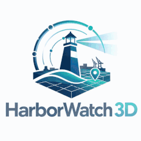
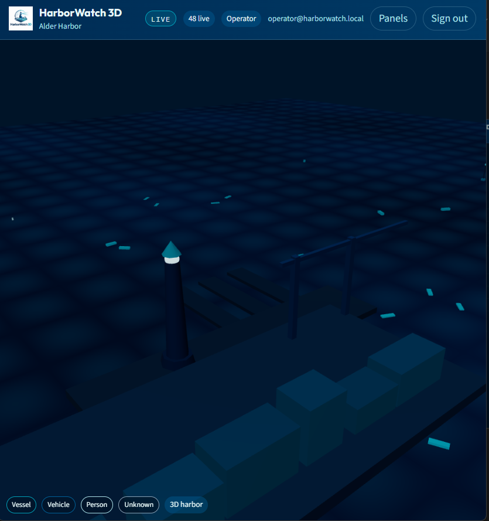
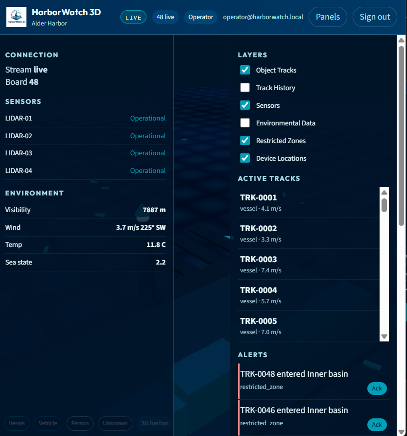
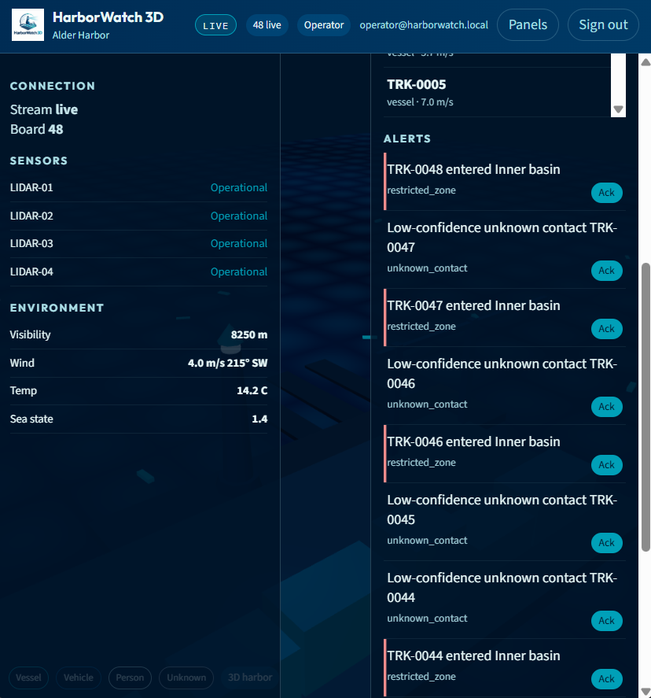
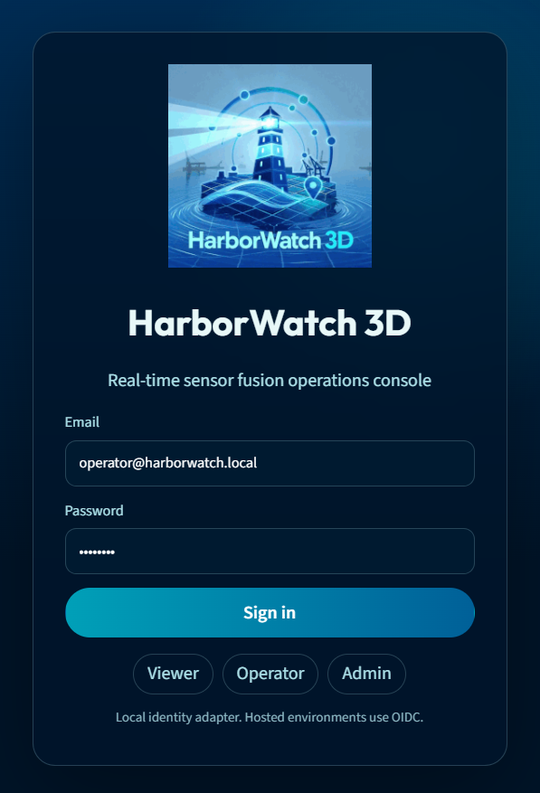
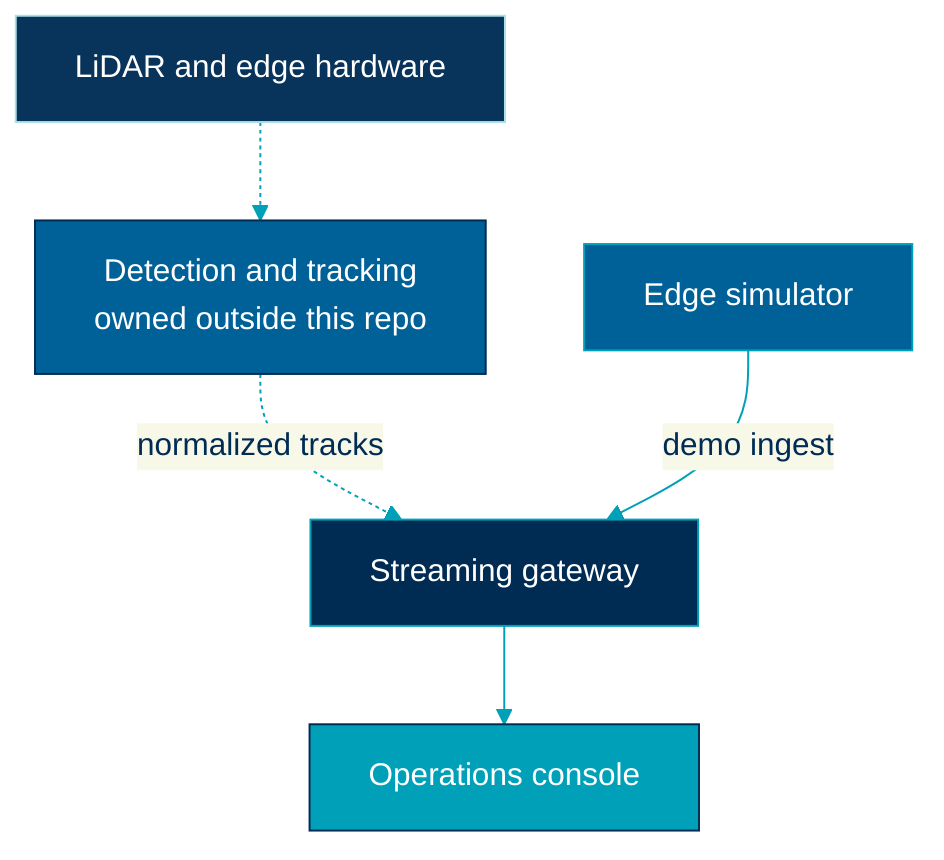

<p align="center">
  
</p>

<h1 align="center">HarborWatch 3D</h1>

<p align="center">
  <strong>Real-time sensor fusion for a harbor operations console</strong>
</p>

<p align="center">
  
  
  
  
</p>

<p align="center">
  <a href="https://github.com/aurelius-in/harborwatch-3d/actions/workflows/ci.yml"></a>
  
</p>

HarborWatch 3D is a public reference implementation of a **secure, account-based operations console**. Edge sensors emit normalized object tracks. A streaming gateway authenticates operators, fans those tracks out over WebSockets, and a React console draws them in 3D with sensor health, weather, alerts, history, and an admin audit trail.

The product is the integration layer: contracts, ingest, RBAC, live sockets, and the board. Detection, SLAM, and point-cloud processing stay with the edge team. GIS internals stay with the GIS team.

<table>
<tr>
<td width="8" bgcolor="#00A0B8"></td>
<td>

<strong>Scope.</strong> Simulated LiDAR-derived tracks on two fictional sites (Alder Harbor and Cedar Inlet). This repository does not represent a government, defense, or proprietary program.

</td>
</tr>
</table>

## The picture

<table>
<tr>
<td width="50%" valign="top">

<br/>
<b>The board.</b> Lighthouse, quay, and warehouses are the site. The cyan marks are normalized tracks, not a point cloud.
</td>
<td width="50%" valign="top">

<br/>
<b>The working set.</b> Four LiDAR units, live weather, layer toggles, and the track roster on one clock.
</td>
</tr>
<tr>
<td width="50%" valign="top">

<br/>
<b>The queue.</b> Inner-basin crossings and low-confidence unknowns. Acknowledge is an Operator action. The API refuses a Viewer.
</td>
<td width="50%" valign="top">

<br/>
<b>The gate.</b> Viewer, Operator, and Admin are roles the API enforces. Hosted identity swaps in as OIDC. This demo uses a local adapter.
</td>
</tr>
</table>

## Architecture

One path, from the edge boundary to the glass.

```mermaid
%%{init: {
  "theme": "base",
  "themeVariables": {
    "primaryColor": "#E8F8F8",
    "primaryTextColor": "#002C54",
    "primaryBorderColor": "#006098",
    "lineColor": "#00A0B8",
    "fontFamily": "Segoe UI, sans-serif"
  }
}}%%
flowchart LR
  edge["Python edge simulator<br/>LiDAR-derived tracks"]
  contract["Shared contracts<br/>TrackUpdate · telemetry · alerts"]
  api["Node gateway<br/>JWT · RBAC · site boards"]
  live["WebSockets<br/>tracks · telemetry · status"]
  glass["React console<br/>3D harbor or SceneView"]

  edge --> contract --> api --> live --> glass

  style edge fill:#006098,stroke:#002C54,color:#FFFFFF
  style contract fill:#ACE0E8,stroke:#006098,color:#002C54
  style api fill:#002C54,stroke:#00A0B8,color:#FFFFFF
  style live fill:#00A0B8,stroke:#002C54,color:#FFFFFF
  style glass fill:#002850,stroke:#ACE0E8,color:#FFFFFF
```



<table>
<tr>
<td align="center" width="20%" bgcolor="#006098">
<font color="#FFFFFF"><b>Edge</b><br/>Python process<br/>two sites, weather, dropouts</font>
</td>
<td align="center" width="20%" bgcolor="#ACE0E8">
<font color="#002C54"><b>Contract</b><br/>one schema<br/>edge, API, and UI agree</font>
</td>
<td align="center" width="20%" bgcolor="#002C54">
<font color="#FFFFFF"><b>Gateway</b><br/>ingest, history, alerts<br/>Postgres or memory</font>
</td>
<td align="center" width="20%" bgcolor="#00A0B8">
<font color="#FFFFFF"><b>Stream</b><br/>site filter<br/>sequence wins</font>
</td>
<td align="center" width="20%" bgcolor="#002850">
<font color="#ACE0E8"><b>Console</b><br/>tracks, layers, audit<br/>desktop to phone</font>
</td>
</tr>
</table>

The dotted path below is what a real deployment would add. This repository runs the solid path, so the demo does not depend on sensor hardware or a point-cloud pipeline.



<table>
<tr>
<td width="33%" valign="top" bgcolor="#002C54">
<font color="#FFFFFF"><b>Application lead</b><br/>Contracts, gateway, console shell, tests, and release.</font>
</td>
<td width="33%" valign="top" bgcolor="#006098">
<font color="#FFFFFF"><b>Edge engineer</b><br/>Track and telemetry streams. This repo consumes the contract, not the detector.</font>
</td>
<td width="33%" valign="top" bgcolor="#007CA8">
<font color="#FFFFFF"><b>GIS engineer</b><br/>SceneView, layers, and symbology. The same track store drives the built-in 3D harbor.</font>
</td>
</tr>
</table>

| Surface | What it owns |
|---|---|
| `services/edge-simulator` | Python producer. Separate process on purpose. |
| `packages/contracts` | `TrackUpdate`, telemetry, alerts, session. |
| `apps/api` | REST, three WebSockets, JWT, site boards, history, audit. |
| `apps/web` | React PWA. Sidebar, drawer, or bottom sheet. |
| `packages/auth` | Local JWT adapter. OIDC is the hosted target, not this demo. |

Sockets: `/ws/tracks`, `/ws/telemetry`, `/ws/status`. A client frame can set `site_id`.  
REST worth opening first: `/api/health`, `/api/tracks`, `/api/tracks/:id/history`, `/api/alerts`.

Deeper diagrams live in [docs/diagrams](./docs/diagrams/system-overview.md). The picture above is the one that matters on this page.

## Run it

```bash
git clone https://github.com/aurelius-in/harborwatch-3d.git
cd harborwatch-3d
cp .env.example .env
docker compose up --build
```

Open [http://localhost:3000](http://localhost:3000).

| Process | URL |
|---|---|
| Console | http://localhost:3000 |
| API | http://localhost:5000 |
| Simulator health | http://localhost:8000/health |

### Demo accounts

| Role | Email | Password |
|---|---|---|
| Viewer | `viewer@harborwatch.local` | `viewer` |
| Operator | `operator@harborwatch.local` | `operator` |
| Admin | `admin@harborwatch.local` | `admin` |

Viewer is read-only. Operator can acknowledge alerts and query track history. Admin can list users, rename a site, and read the audit log. The API is the gate. The UI only reflects it.

### Without Docker

```bash
npm install
pip install -r services/edge-simulator/requirements.txt
# API defaults to in-memory storage when DATABASE_URL is unset or memory://
npm run dev
```

In a second terminal:

```bash
npm run dev:sim
```

Set `VITE_ARCGIS_API_KEY` (and `ARCGIS_API_KEY`) to bind ArcGIS SceneView graphics. With no key, the console uses the built-in 3D harbor scene so the demo is never an empty map.

## What you should see

- About 48 movers on Alder Harbor and about 24 on Cedar Inlet (vessel, vehicle, person, unknown)
- Site switch that filters tracks, sensors, devices, weather, and alerts
- Trails, interpolation on the WebGL board, stale dimming, click-to-inspect (full contract fields plus history for Operator/Admin)
- Layers that actually hide and show tracks, trails, sensors, weather overlay, restricted zones, and device GPS
- Alerts that can fire: zone intrusion, stale/degraded sensor, low visibility. Viewer cannot ack (HTTP 403)
- Admin: users/roles, ingest health, site name, audit of login/ack/layer/site changes
- Connection badge with per-socket lifecycle and exponential reconnect
- Desktop sidebar, tablet drawer, phone bottom sheet. PWA installable.

## Design rules

- Stable `track_id` values. The map updates a track. It does not spawn a new object every tick.
- WebSockets for live motion. REST for session, config, sampled history, and admin.
- Sequence numbers win over wall clocks.
- Stale at 15 s, expire at 45 s. History remains queryable.
- The API is the authorization boundary.

## Palette

From [`hw3d-logo.png`](./hw3d-logo.png). No gold. Animated mark: [`hw3d-logo-loop.gif`](./hw3d-logo-loop.gif).

| Token | Hex | Use |
|---|---|---|
| Navy | `#002C54` | Wordmark, chrome, application core |
| Sea | `#006098` | Edge, sensors, secondary fills |
| Teal | `#00A0B8` | Live accent (the 3D) |
| Beam | `#ACE0E8` | Highlights, contract nodes |
| Mist | `#E8F8F8` | Light docs and diagram fill |
| Deep navy | `#002850` | Night panels |

## Documentation

- [Documentation index](./docs/README.md)
- [Architecture overview](./docs/architecture/overview.md)
- [Contracts](./docs/architecture/contracts.md)
- [Realtime streaming](./docs/architecture/realtime-streaming.md)
- [Security](./docs/architecture/security.md)
- [Deployment](./docs/architecture/deployment.md)

## Tests and CI

```bash
npm test
npm run typecheck
npm run build
npm run test:e2e
```

GitHub Actions runs typecheck, unit/contract tests, Python contract tests, the web build, and a Playwright smoke on every push to `main`.

## Honest limits

- ArcGIS SceneView needs `VITE_ARCGIS_API_KEY`. Without it, the WebGL harbor is the board. The ArcGIS path upserts graphics by `track_id`. It does not mount Esri StreamLayer.
- Identity is a local JWT adapter with seeded demo users. Hosted OIDC is documented as the target, not implemented here.
- PostgreSQL is used when `DATABASE_URL` is a Postgres URL (Docker Compose). `memory://` is the test and no-Docker path.
- Demo secrets in `.env.example` are for local use. Change them before any shared deploy.

## License

MIT. See [LICENSE](./LICENSE).
