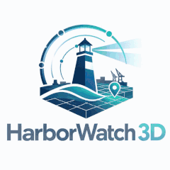

  

<h1 align="center">HarborWatch 3D documentation</h1>

  <strong>Contracts, streaming, and a 3D operations board</strong>

  
  
  
  

HarborWatch 3D is a public reference implementation of a secure, account-based operations console. Sensors around a harbor detect moving objects. The application shows those objects live on a 3D map, together with sensor health, weather, alerts, and historical tracks.

The project models **LiDAR-derived object tracks**, not raw LiDAR, SLAM, or point-cloud processing. Edge and GIS specialists own those internals. This repository owns the **contracts, streaming layer, application UI, and release path** that connect them.

<table>
<tr>
<td width="8" bgcolor="#00A0B8"></td>
<td>

**Scope.** Public architecture and integration reference. Simulated tracks only. It does not represent government, defense, or proprietary program work.

</td>
</tr>
</table>

## Palette

Colors are taken from [`hw3d-logo.png`](../hw3d-logo.png). The README and this index use [`hw3d-logo-loop.gif`](../hw3d-logo-loop.gif). There is no gold in the mark. Use these tokens in diagrams, badges, and callouts.

| Token | Hex | Role |
|---|---|---|
| Background | `#FFFFFF` | Page and diagram canvas |
| Mist | `#E8F8F8` | Soft panel and subgraph fill |
| Beam | `#ACE0E8` | Info callouts, contract nodes |
| Teal | `#00A0B8` | Accent (the **3D**), arrows, live streams |
| Mid cyan | `#007CA8` | Persistence, secondary actions |
| Sea | `#006098` | Edge, sensors, wave and grid |
| Navy | `#002C54` | Wordmark, headings, application core |
| Deep navy | `#002850` | Dark containers and night panels |

Callout convention used across this set:

<table>
<tr><td width="8" bgcolor="#00A0B8"></td><td><strong>Note.</strong> Integration or interview point.</td></tr>
</table>
<table>
<tr><td width="8" bgcolor="#002C54"></td><td><strong>Boundary.</strong> What this system does not own.</td></tr>
</table>
<table>
<tr><td width="8" bgcolor="#006098"></td><td><strong>Contract.</strong> Shared schema or role rule.</td></tr>
</table>

## Architecture

| Document | What it covers |
|---|---|
| [Overview](./architecture/overview.md) | Purpose, principles, and what the screen should look like |
| [System context](./architecture/context.md) | C4 context: users, edge, GIS, and external systems |
| [Containers](./architecture/containers.md) | Web, API, simulator, database, and streaming |
| [Components](./architecture/components.md) | Responsibilities and team boundaries |
| [Data flow](./architecture/data-flow.md) | Edge-to-browser event path |
| [Realtime streaming](./architecture/realtime-streaming.md) | WebSockets, sequencing, reconnect, throttle, stale tracks |
| [Geospatial](./architecture/geospatial.md) | SceneView, coordinates, zones, layers |
| [Contracts](./architecture/contracts.md) | Shared event schemas and versioning |
| [Security](./architecture/security.md) | Auth, RBAC, secrets, and auditability |
| [Observability](./architecture/observability.md) | Logs, metrics, health, tracing, alerts |
| [Deployment](./architecture/deployment.md) | Local, development, staging, and production |
| [Scalability](./architecture/scalability.md) | Performance targets and scale strategy |
| [Testing](./architecture/testing.md) | Unit, integration, contract, E2E, and load |
| [Decisions](./architecture/decisions.md) | Architectural decision records |

## Diagrams

| Document | What it shows |
|---|---|
| [System overview](./diagrams/system-overview.md) | End-to-end architecture |
| [Data flow](./diagrams/data-flow.md) | Track and telemetry streams |
| [Deployment](./diagrams/deployment.md) | Local and hosted environments |

## Start here

1. Run the stack: `docker compose up --build` (see [deployment](./architecture/deployment.md)).
2. Read [architecture overview](./architecture/overview.md) for the product story.
3. Open [system overview diagrams](./diagrams/system-overview.md) for the picture a reviewer should see first.
4. Read [contracts](./architecture/contracts.md) before changing APIs or simulator payloads.

Root product page: [README.md](../README.md).
