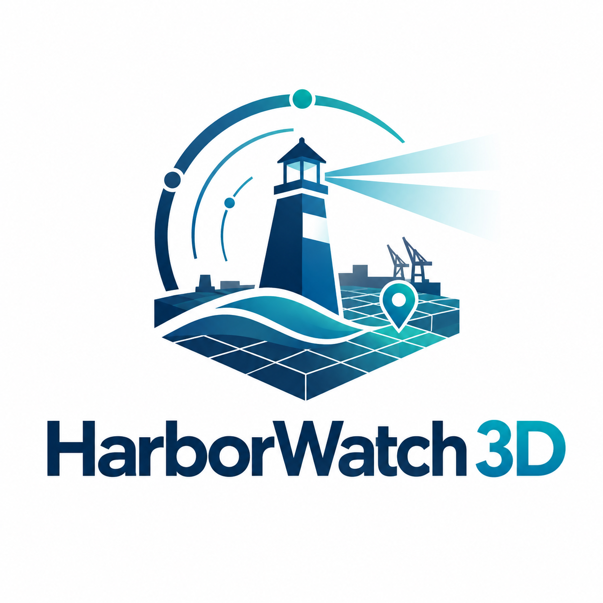
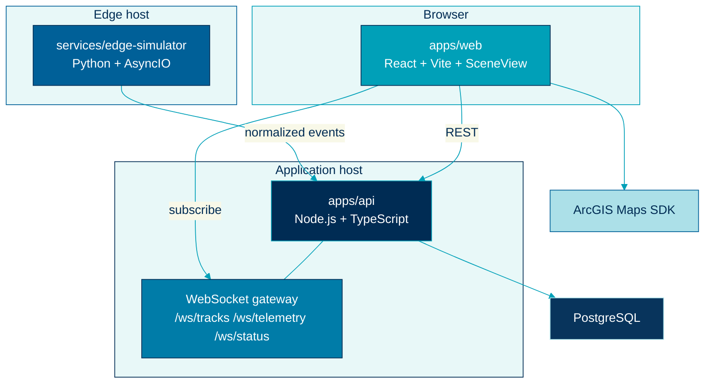

  

# Containers

> Runtime processes: web, API, simulator, database, and streaming sockets.

## Container map

## `apps/web`

| Item | Choice |
|---|---|
| Runtime | Browser (PWA) |
| Stack | React, TypeScript, Vite |
| GIS | ArcGIS Maps SDK `SceneView` when an API key is set; built-in 3D harbor scene otherwise |
| Talks to | REST on `apps/api`, WebSockets, optional ArcGIS |

Responsibilities: layout (desktop sidebar, tablet drawer, phone sheet), layer toggles, track inspector, reconnect banner, RBAC-aware chrome, offline-capable shell.

Local port: `http://localhost:3000`.

## `apps/api`

| Item | Choice |
|---|---|
| Runtime | Node.js |
| Stack | TypeScript, HTTP + WebSocket |
| Talks to | Simulator ingest, PostgreSQL, web clients |

Responsibilities: authentication, RBAC, site-scoped subscriptions, normalized contracts, historical queries, WebSocket lifecycle, structured logs, `/api/health`.

REST surface:

| Method | Path | Purpose |
|---|---|---|
| POST | `/api/auth/login` | Local identity adapter |
| GET | `/api/sites` | Sites the user may see |
| GET | `/api/sensors` | Sensor roster and health snapshot |
| GET | `/api/devices` | Device GPS and heartbeat |
| GET | `/api/tracks` | Snapshot of the live board |
| GET | `/api/tracks/:id/history` | Bounded historical points (operator+) |
| GET | `/api/alerts` | In-app alerts |
| POST | `/api/alerts/:id/ack` | Acknowledge (operator+) |
| GET | `/api/user` | Current session and role |
| GET | `/api/health` | Liveness and dependency flags |
| POST | `/api/ingest` | Simulator or edge service ingest |

WebSocket surface:

| Path | Payload |
|---|---|
| `/ws/tracks` | `TrackUpdate` stream |
| `/ws/telemetry` | Sensor and environmental telemetry |
| `/ws/status` | Connection, device, and alert status |

Local port: `http://localhost:5000`.

## `services/edge-simulator`

| Item | Choice |
|---|---|
| Runtime | Python 3.9+ |
| Stack | AsyncIO, WebSocket or HTTP client |
| Talks to | `apps/api` ingest only |

It pretends to be the edge and streaming team's process. It emits object tracks, sensor health, GPS/device position, temperature, wind, visibility, and connection status.

<table>
<tr>
<td width="8" bgcolor="#00A0B8"></td>
<td>

<strong>Note.</strong> The simulator is a separate service on purpose. In a real architecture that boundary is owned by another engineering discipline.

</td>
</tr>
</table>

Local port: `http://localhost:8000`.

## PostgreSQL

Stores users, site configuration, sensor registry, and historical track samples. Live motion does not round-trip the database on every tick. History writes are batched or sampled so the socket path stays hot.

## Streaming

The API owns the fan-out. The client track store binds `/ws/tracks`. ArcGIS SceneView upserts graphics when a key is present. StreamLayer is a future GIS-team bind, not mounted here. See [realtime streaming](./realtime-streaming.md).

## Related

- [Components](./components.md)
- [Deployment](./deployment.md)
- [Diagrams: deployment](../diagrams/deployment.md)
