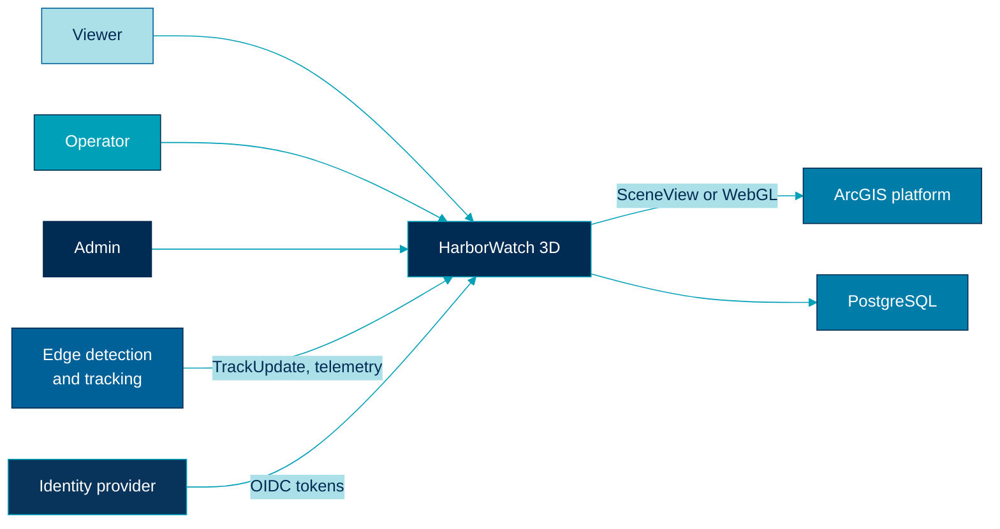

  

# System context

> Who uses HarborWatch 3D, what it talks to, and what stays outside the box.

## In scope

HarborWatch 3D is the **application system**: browser console, streaming API, shared contracts, and a simulated edge producer. People use it to watch a harbor site, inspect tracks, and manage operators.

## Actors

| Actor | Intent | Typical role |
|---|---|---|
| Harbor viewer | Watch live tracks and telemetry | Viewer |
| Duty operator | Acknowledge alerts, inspect history, filter sites | Operator |
| Site admin | Users, sites, sensors, audit | Admin |
| Edge / streaming engineer | Produce `TrackUpdate` and telemetry | External discipline |
| GIS engineer | Scene, layers, symbology, coordinate rules | External discipline |
| Application lead | Contracts, gateway, UI shell, CI/CD | This repository |

<table>
<tr>
<td width="8" bgcolor="#00A0B8"></td>
<td>

<strong>Note.</strong> The application lead does not replace the edge or GIS specialist. They own the interfaces, environments, tests, and application architecture that connect both.

</td>
</tr>
</table>

## External systems

| System | Direction | Why it exists |
|---|---|---|
| Edge detection and tracking | In | Real deployments emit normalized tracks. The simulator stands in. |
| ArcGIS platform | Out | SceneView, basemaps. StreamLayer is a future GIS bind. |
| Identity provider | In | OAuth / OIDC login (adapter in `packages/auth`) |
| PostgreSQL | Out | Users, sites, configuration, track history |
| Email or paging (optional) | Out | Alert escalation in production, not required locally |

## C4 context

## Trust boundary

Everything inside HarborWatch 3D is account-based. Browsers never talk to the edge simulator directly. The API authenticates the user, applies site filters, and then forwards allowed streams.

<table>
<tr>
<td width="8" bgcolor="#002C54"></td>
<td>

<strong>Boundary.</strong> Classified networks, hardware-in-the-loop sensors, and program-specific coordinate pipelines are out of scope. The public repo uses simulated tracks so the architecture can be shown without proprietary systems.

</td>
</tr>
</table>

## Related

- [Containers](./containers.md)
- [Security](./security.md)
- [Diagrams: system overview](../diagrams/system-overview.md)
