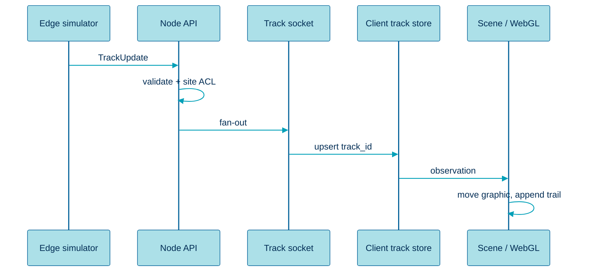

  

# Data flow

> How a detection becomes a moving object on the map.

## Happy path

1. The edge process (simulator today) produces a **normalized** `TrackUpdate`.
2. The API ingest adapter validates the contract and stamps `seq` if missing.
3. The track broker updates an in-memory site board and enqueues a sampled history write.
4. Subscribed browsers on `/ws/tracks` receive the same event.
5. The client track store upserts by `track_id`.
6. The WebGL harbor or ArcGIS SceneView graphics move the existing object and extend the trail.
7. The inspector, if that ID is selected, refreshes attributes.

Telemetry and status use the same ingest-to-socket shape on `/ws/telemetry` and `/ws/status`.

## Sequence

## Filtering

| Layer | Filter |
|---|---|
| Simulator | Emits one or more `site_id` scenarios |
| API | User may only subscribe to permitted sites |
| Socket | Optional object-type and bounding-box filters |
| Client | Layer toggles hide renderers; they do not unsubscribe unless asked |

## History path

Live ticks are not the source of truth for replay. Sampled points land in PostgreSQL. `GET /api/tracks/:id/history` returns a bounded series for the inspector and a future playback control.

## Failure path

| Failure | Client sees | Recovery |
|---|---|---|
| Ingest down | Tracks freeze, health stale | Simulator retry, API health red |
| Socket drop | Reconnect badge | Resume with last `seq` |
| Invalid payload | Server log, drop event | Contract test fails in CI |
| Stale track | Graphic fades, then purge | New update revives the ID |

See the picture form in [diagrams/data-flow.md](../diagrams/data-flow.md).

## Related

- [Realtime streaming](./realtime-streaming.md)
- [Contracts](./contracts.md)
- [Overview](./overview.md)
