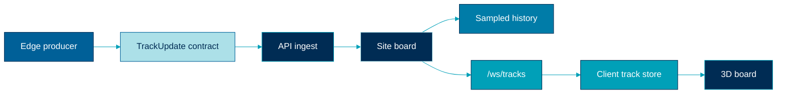
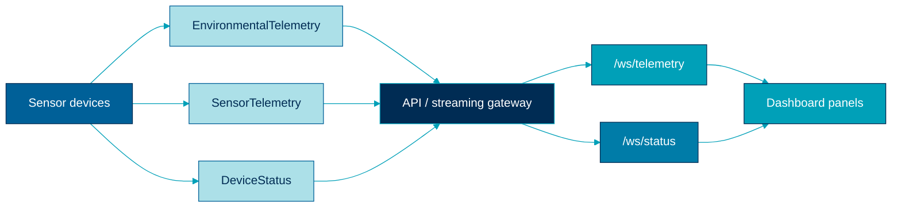
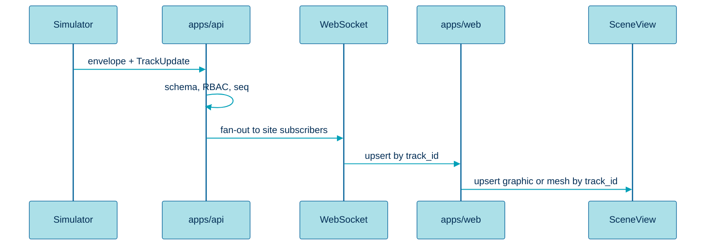

  

# Data-flow diagrams

> Track and telemetry movement from edge to SceneView.

## Track path

## Telemetry path

## Sequence (one update)

## Related

- [Data flow](../architecture/data-flow.md)
- [Realtime streaming](../architecture/realtime-streaming.md)
- [Contracts](../architecture/contracts.md)
