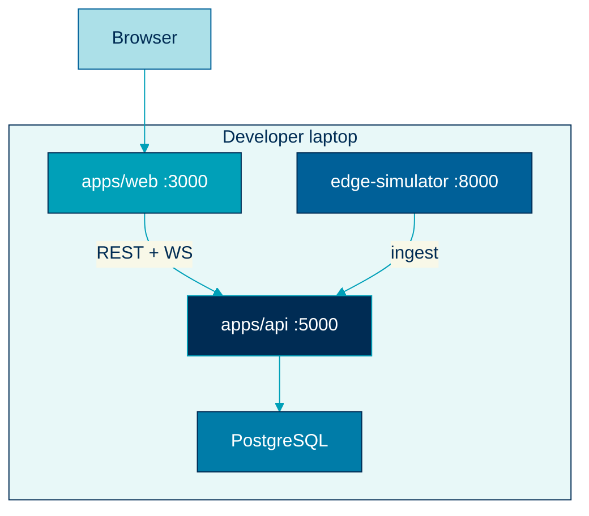
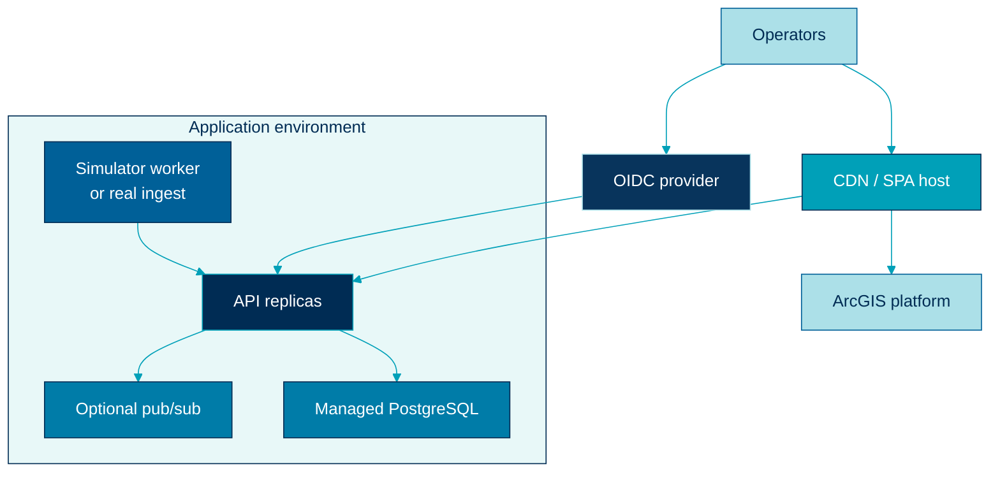

  

# Deployment diagrams

> Local Compose and a hosted staging or production shape.

## Local Compose

## Hosted

## Pipeline

```mermaid
%%{init: {
  "theme": "base",
  "themeVariables": {
    "primaryColor": "#E8F8F8",
    "primaryTextColor": "#002C54",
    "lineColor": "#00A0B8"
  }
}}%%
flowchart LR
  pr["PR"] --> lint["lint"]
  lint --> unit["unit"]
  unit --> integ["integration"]
  integ --> build["web + image build"]
  build --> scan["security scan"]
  scan --> stage["staging"]
  stage --> smoke["smoke"]
  smoke --> approve["production approval"]

  style pr fill:#ACE0E8,stroke:#006098,color:#002C54
  style lint fill:#006098,stroke:#002C54,color:#FFFFFF
  style unit fill:#006098,stroke:#002C54,color:#FFFFFF
  style integ fill:#007CA8,stroke:#002C54,color:#FFFFFF
  style build fill:#002C54,stroke:#00A0B8,color:#FFFFFF
  style scan fill:#002C54,stroke:#ACE0E8,color:#FFFFFF
  style stage fill:#00A0B8,stroke:#002C54,color:#FFFFFF
  style smoke fill:#00A0B8,stroke:#002850,color:#FFFFFF
  style approve fill:#002C54,stroke:#00A0B8,color:#FFFFFF
```

## Related

- [Deployment](../architecture/deployment.md)
- [Testing](../architecture/testing.md)
- [Security](../architecture/security.md)
