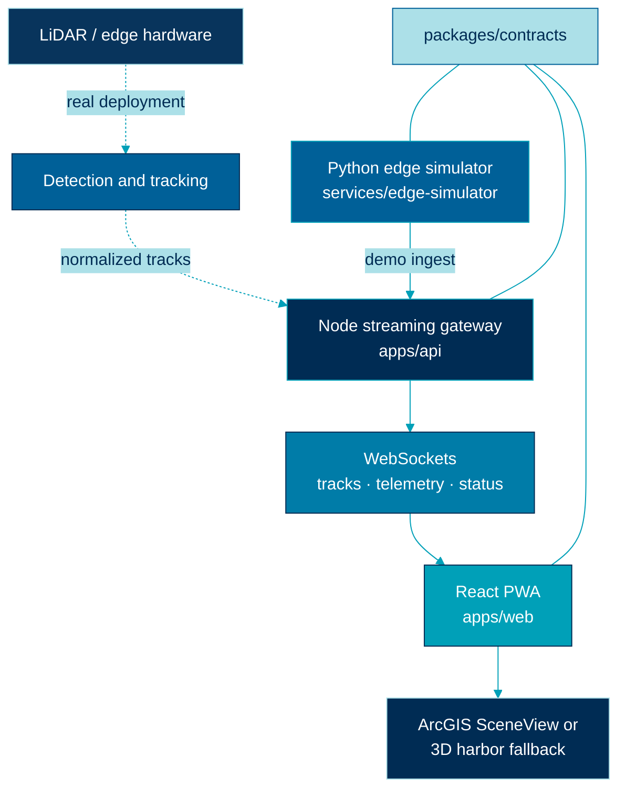
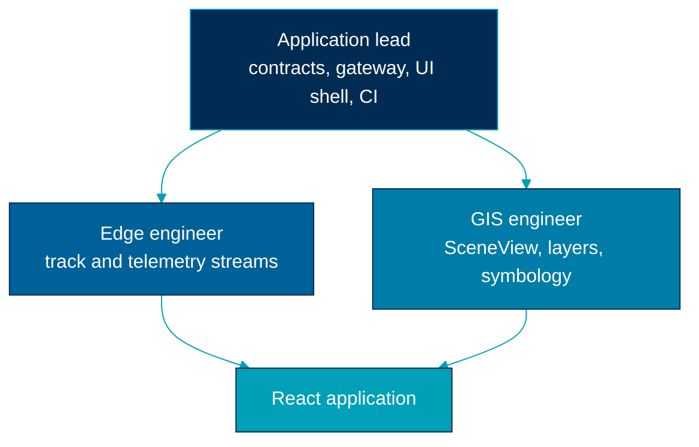
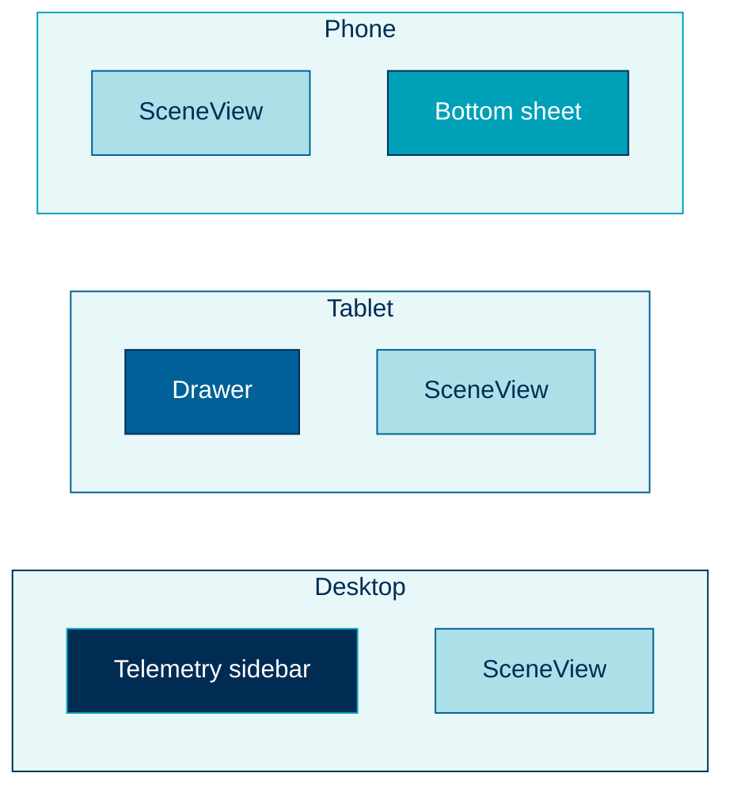

  

# System overview diagrams

> End-to-end HarborWatch 3D architecture in the logo palette.

**Colors.** Navy `#002C54` application core · Sea `#006098` edge · Teal `#00A0B8` live UI and streams · Beam `#ACE0E8` contracts · Mid cyan `#007CA8` data.

## Integration stack

Dotted arrows are the production edge path. Solid arrows are what this repository runs locally.

## Application lead and specialists

## Console layout

## Related

- [Architecture overview](../architecture/overview.md)
- [Context](../architecture/context.md)
- [Containers](../architecture/containers.md)
